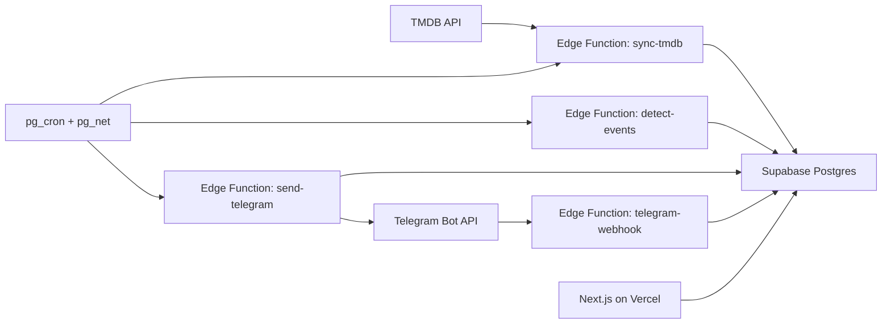

# NowLanding

Release-day alerts for movies and series, on Telegram or in the web app.

NowLanding messages you when:

- **Movies:** a popular upcoming movie is announced, and on the theatrical, digital and physical (Blu-ray/DVD) release day. Physical releases only alert on the day itself.
- **Series:** an anticipated series premieres, a new season premieres, and every new episode of series you follow.

You get automatic alerts for popular titles and can follow specific titles. Movie dates follow your region. Every alert is also listed in the web app at `/notifications`, whether or not Telegram is connected.

## Stack

- Next.js 16 (App Router) on Vercel, plain CSS
- Supabase: Postgres, Auth, Edge Functions (Deno), pg_cron
- TMDB as the only data source
- Email/password login; Telegram connected optionally for alerts (the sender sits behind a `Channel` interface, so other channels can be added)

## How it works



| Job | Schedule | What it does |
| --- | --- | --- |
| `nowlanding-discover` | daily | Finds popular upcoming titles |
| `nowlanding-refresh` | every 10 min | Re-fetches dates for tracked titles |
| `nowlanding-detect` | every 30 min | Turns date changes into notifications |
| `nowlanding-send` | every minute | Sends pending notifications to Telegram |

Schedules live in `supabase/migrations/*_cron_schedules.sql`. Notifications are unique per user, title, event type and event key, so reruns never send twice.

## Local setup

Requirements: Node 20+, pnpm, Docker, the [Supabase CLI](https://supabase.com/docs/guides/cli), a [TMDB](https://developer.themoviedb.org) read access token, and a Telegram bot token from [@BotFather](https://t.me/BotFather).

```bash
pnpm install
supabase start
```

`supabase start` prints the local API URL and keys. Create the two env files from the examples:

```bash
cp .env.example .env.local
cp supabase/functions/.env.example supabase/functions/.env
```

| File | Variable | Value |
| --- | --- | --- |
| `.env.local` | `NEXT_PUBLIC_SUPABASE_URL` | local API URL |
| `.env.local` | `NEXT_PUBLIC_SUPABASE_PUBLISHABLE_KEY` | publishable key from `supabase status` |
| `.env.local` | `SUPABASE_SECRET_KEY` | secret key from `supabase status` (server only) |
| `.env.local` | `TMDB_READ_TOKEN` | your TMDB token |
| `.env.local` | `TELEGRAM_BOT_USERNAME` | your bot's username |
| `.env.local` | `CRON_SECRET` | any random string |
| `supabase/functions/.env` | `TMDB_READ_TOKEN`, `TELEGRAM_BOT_TOKEN`, `TELEGRAM_WEBHOOK_SECRET`, `APP_URL` (your deployed site URL in production) | your values |

Start the app:

```bash
pnpm dev   # http://localhost:3001
```

The local Auth server auto-confirms sign-ups (no email is sent); a hosted project sends a confirmation email.

### Load data

The database starts empty. Run discover once, then refresh until `remaining` is 0:

```bash
KEY=$(supabase status -o env | grep '^SECRET_KEY' | cut -d'"' -f2)
curl -X POST http://127.0.0.1:54321/functions/v1/sync-tmdb \
  -H "apikey: $KEY" -H "Content-Type: application/json" -d '{"mode":"discover"}'
curl -X POST http://127.0.0.1:54321/functions/v1/sync-tmdb \
  -H "apikey: $KEY" -H "Content-Type: application/json" -d '{"mode":"refresh"}'
```

The functions only accept the secret key in the `apikey` header, not as a Bearer token.

### Tests

```bash
pnpm test    # Vitest: event detection, date logic, message building
pnpm lint
```

## Deploy

1. Create a Supabase project and push the schema: `supabase link` then `supabase db push`.
2. Deploy the functions: `supabase functions deploy`, and set the secrets from `supabase/functions/.env`.
3. Store `project_url` and `secret_key` in Supabase Vault. The cron jobs read them to call the functions.
4. Set the bot webhook to the `telegram-webhook` function with a `secret_token` equal to `TELEGRAM_WEBHOOK_SECRET`.
5. Configure auth in the Supabase dashboard (Authentication > Sign In / Providers): the email provider is on by default. For Google and GitHub, create OAuth apps with redirect URI `https://<project-ref>.supabase.co/auth/v1/callback`, enable both providers with the client IDs and secrets, and publish the Google consent screen (it needs a home page and privacy policy URL; this repo serves `/privacy`). Set the Site URL (Authentication > URL Configuration) to your deployed URL.
6. Import the repo in Vercel and set the variables from `.env.example` in the project settings (use the hosted Supabase URL and keys). Vercel then deploys every push to `main`. `vercel.json` has a daily cron that calls `/api/keepalive` (checks `Authorization: Bearer $CRON_SECRET`) so a free Supabase project does not pause after 7 days of inactivity.

## Project layout

- `app/`: routes and server actions
- `components/`: UI components
- `lib/`: data queries, TMDB client, Supabase clients
- `supabase/migrations/`: schema, RLS and cron schedules
- `supabase/functions/`: the four Edge Functions, plus `_shared/` pure modules used by Deno, Vitest and Next.js

All tables use row-level security. Users read and write only their own profile, follows and notifications. Jobs use the secret key server-side only.

## Notes on the data

- TMDB has no "anticipated" metric. Popularity of unreleased titles is the proxy.
- TMDB does not separate DVD from Blu-ray and the data is often missing, so both are one "physical release".
- Series air dates are not per region. Region applies to movies only.
- Cached TMDB data is kept for at most 6 months. Untracked, unfollowed titles not refreshed in 180 days are purged.

## License

[MIT](LICENSE)

## Attribution

This product uses the TMDB API but is not endorsed or certified by TMDB.
